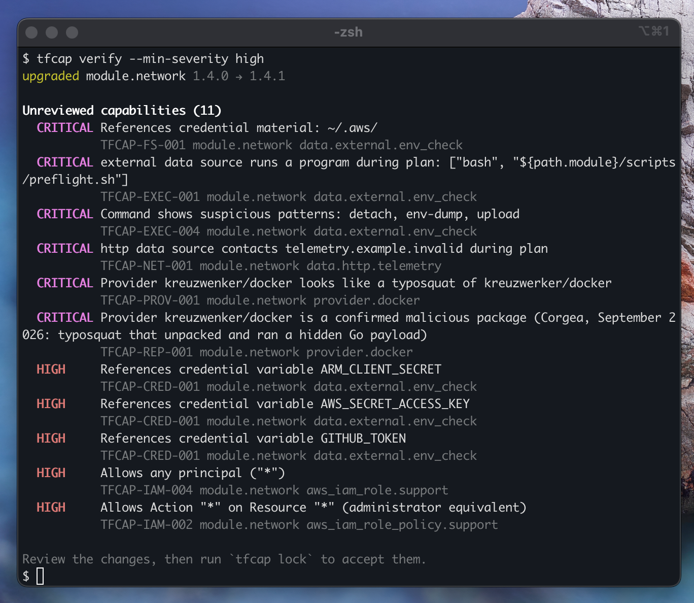
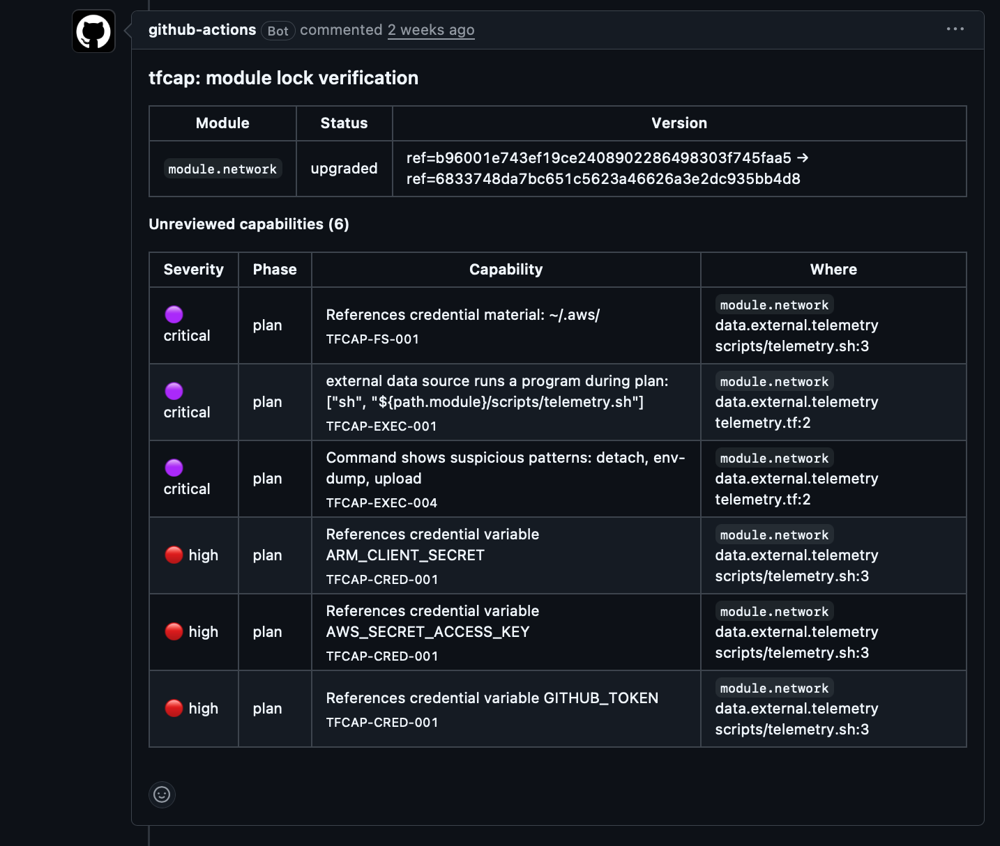

# tfcap

[](https://securityscorecards.dev/viewer/?uri=github.com/r-morato/tfcap) [](SECURITY.md#verifying-a-release) [](https://github.com/marketplace/actions/tfcap-plan-guard)

**A lock file for Terraform and OpenTofu modules.**

Terraform pins your providers in `.terraform.lock.hcl`, but nothing pins your modules. If someone moves a git tag or swaps a registry release, your next `init` quietly pulls different code. And because `data "external"` and `data "http"` run during `plan`, that code can run in CI with your cloud credentials before anyone has approved anything.

It isn't theoretical: in August the [Coder registry compromise](https://labs.cloudsecurityalliance.org/research/csa-research-note-coder-registry-terraform-supply-chain-2026/) served Terraform modules that stole cloud and CI credentials. More background in [docs/why.md](docs/why.md).

tfcap records a fingerprint of every third-party module and what it can do: run programs, call the network, read credentials, grant IAM. On every pull request it shows you only what changed.



That's a Renovate-style "patch" bump of a VPC module. The example is in [`examples/upgrade-attack`](examples/upgrade-attack), and it's inert: every endpoint uses the reserved `.invalid` domain.

## How it works

1. **Lock once.** `tfcap lock` writes `tfcap.lock.json` with each module's content hash, the commit it resolved to, and its capabilities. Commit it.
2. **Verify on every PR.** `tfcap verify` compares against the lock:
   - a normal upgrade only shows capabilities that are **new**, so you review the difference, not the whole module again;
   - the **same version with different content** (a moved tag, a swapped release) is flagged as `MUTATED`, always critical.
3. **Approve with a label.** With the GitHub Action, add `tfcap-approved` to the PR and the lock file is updated and committed for you.

It reads source code only. It never runs Terraform and never touches the network, unless you ask it to with `tfcap sandbox` or `--online`.

## Install

```sh
go install github.com/r-morato/tfcap/cmd/tfcap@latest
```

Needs Go 1.25+. If the shell can't find `tfcap`, add `$(go env GOPATH)/bin` to your PATH. Prefer a binary? Signed builds for Linux, macOS and Windows are on the [releases page](https://github.com/r-morato/tfcap/releases).

## Quick start

```sh
terraform init -backend=false   # or tofu init
tfcap scan                      # see what your modules can do
tfcap lock                      # write tfcap.lock.json, then commit it
tfcap verify                    # in CI: exit 1 on anything new and high or critical
```

## GitHub Action

```yaml
# .github/workflows/tfcap.yml
name: tfcap
on: pull_request
permissions:
  contents: read
  pull-requests: write     # PR comment
  security-events: write   # code-scanning alerts
jobs:
  tfcap:
    runs-on: ubuntu-latest
    steps:
      - uses: actions/checkout@3d3c42e5aac5ba805825da76410c181273ba90b1 # v7.0.1
        with:
          persist-credentials: false
      - uses: hashicorp/setup-terraform@dfe3c3f87815947d99a8997f908cb6525fc44e9e # v4.0.1
      - run: terraform init -backend=false -input=false
        working-directory: infra
      - uses: r-morato/tfcap@v0  # pin to a commit SHA in production
        with:
          working-directory: infra
```

It comments on the PR, puts code-scanning alerts on the `module` block that pulled the change in, and fails the check if something risky shows up:



See it on [a demo pull request](https://github.com/r-morato/tfcap-action-demo/pull/1). The full setup, including label approval and a daily check for moved tags, is in [docs/github-action.md](docs/github-action.md).

## What it catches

| | Examples |
|---|---|
| **Moved tags, swapped releases** | Same version, different content. Also provider checksums that change under the same version. |
| **Code that runs during plan** | `data "external"`, `data "http"`, `local-exec`, and the helper scripts they call: downloads piped to a shell, env dumps, `base64 -d`, detached processes |
| **Credential access** | `~/.aws`, `~/.ssh`, `~/.kube`, cloud metadata endpoints, `AWS_SECRET_ACCESS_KEY`, `GITHUB_TOKEN`, `TF_TOKEN_*`, and secrets flowing into HTTP calls or commands |
| **Hidden behaviour** | Hosts and commands assembled with `join()`, `format()` or `base64decode()`, encoded blobs, binaries shipped inside modules |
| **Risky providers** | Typosquats of about 90 popular providers, known-malicious packages, custom registry hosts |
| **IAM** | `*:*` admin grants, privilege-escalation actions, `Principal: "*"` |

Full list with rationale: [docs/rules.md](docs/rules.md).

## FAQ

**Why not just pin exact versions?**
An exact `version = "1.2.0"` stops surprise upgrades, but on the public registry a version is a git tag, and tags can be moved. [BoostSecurity Labs](https://labs.boostsecurity.io/articles/erosion-of-trust-unmasking-supply-chain-vulnerabilities-in-the-terraform-registry/) found hundreds of registry modules whose tags could be hijacked. tfcap locks the content itself.

**What if I already pin git sources to commit SHAs?**
That's the best you can do with plain Terraform, and `tfcap pin` will do it for you. Two gaps remain: modules called *inside* the module you pinned can still use tags or versions, and when you bump the SHA you still have to read the diff yourself. tfcap covers every module in the tree and shows only what the new version can do that the old one couldn't.

**Isn't this what Checkov or Trivy do?**
No, and you should keep running them. They're excellent at "this S3 bucket is public". On the demo module above, Checkov flags the wildcard IAM policy but not the script that runs during plan, the HTTP call, or the typosquatted provider. tfcap looks at what third-party code *does* and how that changes between versions.

**Doesn't keeping a lock file add work?**
A little. Routine upgrades that add nothing risky pass quietly, and approving the rest is one label on the PR. The goal is that reviewing a Renovate bump takes seconds, not a module read-through.

## More

- **`tfcap sandbox`** (Linux): runs a real `plan` with no network and decoy credentials, and reports what it tried, including credentials caught leaving. Try it on [`examples/sandbox-canary`](examples/sandbox-canary).
- **`tfcap pin`**: rewrites git module refs to the exact commit they resolved to.
- **`tfcap.hcl`**: accept specific findings on purpose, with a reason, an approver and an expiry date.
- **`tfcap sbom`**: CycloneDX SBOM of your modules and providers.
- **`--online`**: optional registry, GitHub and OpenSSF Scorecard checks (missing, renamed or brand-new repos).
- Works with **Terragrunt**, **pre-commit** and **GitLab CI**.

Everything is documented in [docs/usage.md](docs/usage.md).

## Benchmark

On 27 popular module repositories (197 modules), tfcap took 4.6 seconds in total, and 14 repositories had no findings at all. Every critical and high finding was a module that genuinely runs programs, such as `terraform-aws-lambda` running Python during plan. Details: [docs/benchmark.md](docs/benchmark.md).

## Limitations

- It's static analysis. Values that only exist at run time can't be followed, which is what `tfcap sandbox` is for.
- IAM checks are AWS-focused. Use Checkov or Trivy for deep policy analysis.
- Provider binaries aren't analysed, only their identity and checksums.

## Contributing

Issues and PRs welcome, especially false positives from popular modules and (sanitised) real-world malicious samples. See [CONTRIBUTING.md](CONTRIBUTING.md). Report vulnerabilities in tfcap itself privately: [SECURITY.md](SECURITY.md).

## License

Apache-2.0
