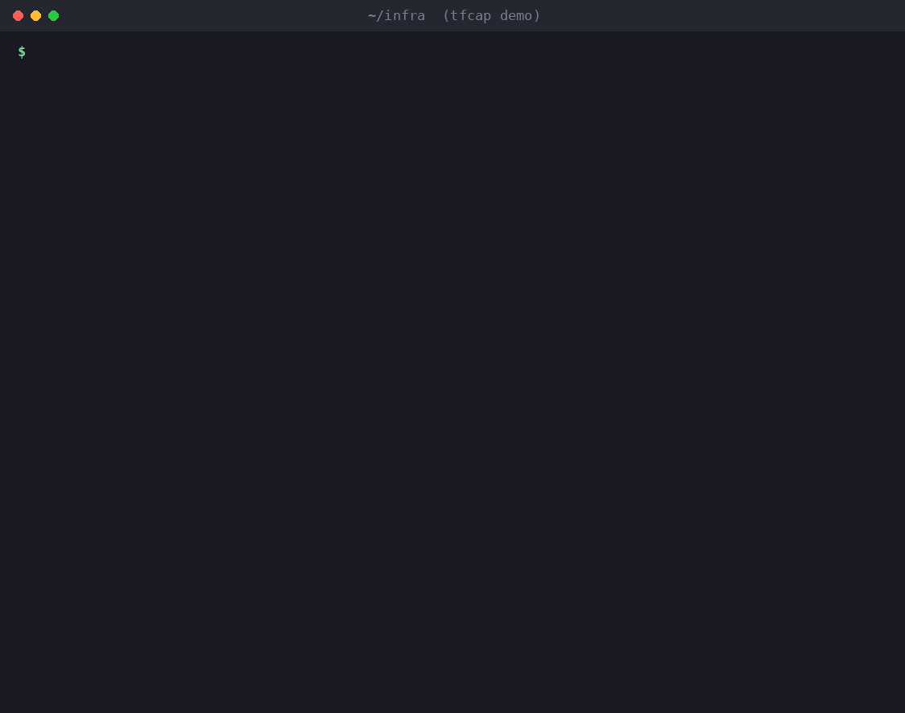

# tfcap

**Know what your Terraform modules can *do* before `terraform plan` does it.**

`tfcap` inventories the capabilities of every Terraform/OpenTofu module and provider in a configuration (running programs, calling the network, reading credentials, granting IAM) and tells you when an upgrade changes them. It also adds the integrity check Terraform never had for modules: a lock file that catches a re-pointed git tag or a tampered registry release.

Think of it as *Socket.dev for Terraform*. It complements Checkov, Trivy and KICS; it doesn't replace them.



The same thing as a one-off comparison of two trees:

```
$ tfcap diff before/ after/

Module changes
  changed  module.network registry.terraform.io/acme-oss/network/aws@1.4.0 → …@1.4.1

New capabilities (13)
  + CRITICAL References credential material: ~/.aws/
             TFCAP-FS-001 module.network data.external.env_check scripts/preflight.sh:4
  + CRITICAL external data source runs a program during plan: ["bash", "${path.module}/scripts/preflight.sh"]
             TFCAP-EXEC-001 module.network data.external.env_check telemetry.tf:10
  + CRITICAL Command shows suspicious patterns: detach, env-dump, upload
             TFCAP-EXEC-004 module.network data.external.env_check telemetry.tf:10
  + CRITICAL http data source contacts telemetry.example.invalid during plan
             TFCAP-NET-001 module.network data.http.telemetry telemetry.tf:14
  + CRITICAL Provider kreuzwenker/docker looks like a typosquat of kreuzwerker/docker
             TFCAP-PROV-001 module.network provider.docker versions.tf:9
  + HIGH     References credential variable AWS_SECRET_ACCESS_KEY
  + HIGH     Allows Action "*" on Resource "*" (administrator equivalent)
  …
```

That's a patch release of a VPC module. The full example lives in [`examples/upgrade-attack`](examples/upgrade-attack). It is inert: every endpoint uses the reserved `.invalid` TLD.

---

## Why this exists

Terraform's supply chain has three structural gaps that the misconfiguration scanners weren't built to cover.

**1. Modules have no lock file.** `.terraform.lock.hcl` pins provider *hashes*. It records nothing at all about modules, and OpenTofu inherited the same design. A git module pinned to `?ref=v1.2.0` runs whatever that tag points at today. Tags can be moved, and research from [BoostSecurity Labs](https://labs.boostsecurity.io/articles/erosion-of-trust-unmasking-supply-chain-vulnerabilities-in-the-terraform-registry/) found hundreds of public registry modules whose release tags could be hijacked.

**2. Code runs during `plan`.** `data "external"` executes a program, and `data "http"` makes a request, while Terraform *reads* data sources. That happens during plan, before any human approves anything, in a CI job that usually holds cloud credentials. "We review the plan before apply" doesn't protect you here.

**3. Scanners judge resources, not behavior.** Misconfiguration scanners are excellent at "this S3 bucket is public." They aren't designed to answer "this module started executing a shell script in its latest patch release."

This isn't hypothetical. In 2026 alone:
- **Coder registry compromise (Aug 31).** For about 14 hours, a compromised module registry served Terraform modules that stole cloud, CI/CD and AI API credentials ([CSA research note](https://labs.cloudsecurityalliance.org/research/csa-research-note-coder-registry-terraform-supply-chain-2026/)).
- **Typosquatted Docker provider (September).** `kreuzwenker/docker` unpacked a payload hidden in a `.sqlite3` file and ran it as a detached Go program ([Corgea](https://corgea.com/research/graphalgo-terraform-go-modules-september-2026/)).

### What existing tools see

On the demo module above, **Checkov 3.3.28** (default Terraform checks) reports 13 findings. They cover the wildcard IAM policy and the open trust policy (it does that well) plus VPC hygiene. **None** of them cover the `external` program that runs during plan, the plan-time HTTP POST, the script that reads `~/.aws/credentials`, or the typosquatted provider. That's not a bug in Checkov; it's a different question. Run both.

| | Misconfig scanners (Checkov, Trivy, KICS) | `tfcap` |
|---|---|---|
| Insecure resource settings | ✅ deep coverage | IAM wildcards only |
| Programs/requests run during plan | No | ✅ |
| Credential paths & env vars read by modules | No | ✅ incl. helper scripts |
| Capability *changes* across module versions | No | ✅ `diff` / `verify` |
| Module content integrity (tag mutation) | No | ✅ `lock` / `verify` |
| Provider typosquatting | No | ✅ |
| `.tf.json` and unparseable-file handling | varies | ✅ |

---

## Install

Requires Go 1.25 or newer.

```sh
go install github.com/r-morato/tfcap/cmd/tfcap@latest
```

`go install` puts the binary in `~/go/bin` (on Windows, `%USERPROFILE%\go\bin`). If your shell says `tfcap: command not found`, add that folder to your PATH:

```sh
# macOS / Linux with zsh (use ~/.bashrc for bash)
echo 'export PATH="$PATH:$(go env GOPATH)/bin"' >> ~/.zshrc && source ~/.zshrc
```

The Windows Go installer usually adds its folder to PATH for you. Check it works with `tfcap version`.

Prebuilt binaries for Linux, macOS and Windows (Intel and ARM) are attached to each [release](https://github.com/r-morato/tfcap/releases) if you'd rather not install Go. Each release also has a `checksums.txt`.

## Try it in two minutes

- **[`examples/testkit`](examples/testkit)**: ten small, defused Terraform configurations, one per kind of risk, and a `run-all.sh` that checks tfcap catches each one.
- **[`examples/realworld-lab`](examples/realworld-lab)**: a hands-on lab with a real `terraform init`. A module maintainer gets compromised, the tag you pinned is quietly moved to malicious code, Terraform downloads it without a warning, and `tfcap verify` stops it before `plan`. Needs git and Terraform or OpenTofu; no cloud account.

## Quick start

`tfcap` reads source code only. It never runs Terraform and never talks to the network.

```sh
terraform init -backend=false   # or tofu init; downloads modules into .terraform/modules
tfcap scan                      # inventory everything
tfcap scan --third-party-only --min-severity medium
```

Without `init`, `tfcap` still scans the root and its local modules, and lists the remote ones it couldn't see.

### Lock and verify (recommended for CI)

```sh
tfcap lock          # writes tfcap.lock.json: per-module content hash + reviewed capabilities
git add tfcap.lock.json
```

Then, on every pull request:

```sh
terraform init -backend=false
tfcap verify        # exit 1 if anything is unreviewed at or above --fail-on (default: high)
```

`verify` reports each third-party module as one of:

| Status | Meaning |
|---|---|
| `ok` | Same source, version and content as locked. |
| `upgraded` | Version or source changed. Only capabilities **not** in the lock are reported. |
| `MUTATED` | **Same version, different content.** The tag was moved or the release was swapped. Always critical. |
| `new` | Module not in the lock; all of its capabilities are reported. |
| `removed` | In the lock, no longer used. |

After reviewing an upgrade, run `tfcap lock` again and commit. The lock diff in the PR then shows exactly which capabilities you accepted.

### Diff two trees or reports

```sh
tfcap diff main-checkout/ pr-checkout/
tfcap scan --format json -o base.json    # on the base branch
tfcap scan --format json -o head.json    # on the PR branch
tfcap diff base.json head.json --format markdown > comment.md
```

## Commands

| Command | What it does |
|---|---|
| `tfcap scan [dir]` | Inventory capabilities. Formats: `text`, `json`, `sarif`. |
| `tfcap diff <base> <head>` | Capabilities added/removed. Each side is a directory or a JSON report. Formats: `text`, `json`, `markdown`, `sarif`. |
| `tfcap lock [dir]` | Write `tfcap.lock.json`. |
| `tfcap verify [dir]` | Check against the lock. Formats: `text`, `json`, `markdown`, `sarif`. |
| `tfcap rules` | List every rule (`--format markdown` for docs). |

Common flags: `--fail-on <severity|none>`, `--min-severity`, `--third-party-only`, `--format`, `--output`, `--data-dir`, `--no-color`, and for SARIF `--sarif-base <dir>` (the scanned folder relative to the repository root).
Exit codes: `0` ok, `1` findings at or above `--fail-on`, `2` usage or runtime error.

## What it detects

The full catalog, with rationale, is in [docs/rules.md](docs/rules.md). The highlights:

| Area | Examples |
|---|---|
| **Execution** | `data "external"` (plan-time), `local-exec`, `remote-exec`, `shell_script`; download-and-execute, env dumps, `/dev/tcp`, `base64 -d`, detached processes. Helper scripts referenced via `${path.module}` are opened and scanned too. |
| **Network** | `data "http"` (critical when the URL is interpolated and data is sent), DNS data sources, hard-coded hosts and public IPs |
| **Credentials** | `~/.aws`, `~/.ssh`, `~/.kube`, `~/.docker`, gcloud ADC, `credentials.tfrc.json`, cloud metadata endpoints; `AWS_SECRET_ACCESS_KEY`, `GITHUB_TOKEN`, `ACTIONS_ID_TOKEN_REQUEST_TOKEN`, `TF_TOKEN_*`… |
| **Obfuscation** | Large base64/hex blobs, `base64decode("<constant>")`, compiled binaries shipped inside modules, unparseable files |
| **IAM** | `*:*` admin grants, `service:*`, `NotAction`, privilege-escalation actions, `Principal: "*"`. Covers `aws_iam_policy_document`, `jsonencode({...})` and heredoc JSON. |
| **Module sources** | Unpinned git, tag/branch refs instead of SHAs, inexact registry versions, archive URLs, plain-HTTP transports, content changed under the same version |
| **Providers** | Typosquats of ~90 popular providers, custom registry hosts, exec-capable providers, community namespaces in third-party code |

Every finding records the **phase** it fires in (`init`, `plan`, `apply`, `static`). Anything in `plan` runs before your approval gate.

## GitHub Action

[](https://github.com/marketplace/actions/tfcap-plan-guard)

On every pull request, tfcap Plan Guard checks your modules against `tfcap.lock.json` before anything runs `terraform plan`. When something changes, it comments on the PR, adds code-scanning alerts on the `module` block that pulled the change in, and fails the check.

**See it live:** [this demo pull request](https://github.com/r-morato/tfcap-action-demo/pull/1) bumps a module to a version that steals credentials during plan.

### Setup

1. **Lock your modules** (locally, once):
   ```sh
   cd infra                       # your Terraform root module
   terraform init -backend=false
   tfcap lock                     # writes tfcap.lock.json
   git add tfcap.lock.json && git commit -m "Lock Terraform module capabilities"
   ```
2. **Add the workflow** as `.github/workflows/tfcap.yml`:
   ```yaml
   name: tfcap
   on:
     pull_request:
     push:
       branches: [main]
   permissions:
     contents: read
     pull-requests: write     # PR comment
     security-events: write   # code-scanning alerts
   jobs:
     tfcap:
       runs-on: ubuntu-latest
       steps:
         - uses: actions/checkout@3d3c42e5aac5ba805825da76410c181273ba90b1 # v7.0.1
         - uses: hashicorp/setup-terraform@dfe3c3f87815947d99a8997f908cb6525fc44e9e # v4.0.1
         - run: terraform init -backend=false -input=false
           working-directory: infra
         - uses: r-morato/tfcap@v0  # pin to a commit SHA in production
           with:
             working-directory: infra
   ```
3. **When a PR changes a module**, review what tfcap reports. If you accept it, run `tfcap lock` again and commit the updated lock file in the same PR; the lock-file diff then records exactly what you approved.

### Inputs

| Input | Default | Description |
|---|---|---|
| `working-directory` | `.` | Terraform root module, relative to the repository root. Run `terraform init` or `tofu init` there first. |
| `mode` | `verify` | `verify`: compare against `tfcap.lock.json` and report only unreviewed changes. `scan`: report everything (no lock file needed). |
| `fail-on` | `high` | Fail the check at or above this severity: `none`, `info`, `low`, `medium`, `high`, `critical`. |
| `min-severity` | `low` | Hide findings below this severity in the comment and alerts. |
| `third-party-only` | `true` | `scan` mode only: ignore capabilities in your own modules. |
| `comment` | `true` | Post a PR comment, and update the same comment on later pushes. |
| `sarif` | `true` | Upload results to GitHub code scanning (needs `security-events: write`). |
| `version` | *(empty)* | Empty builds tfcap from the Action's own source, so the scanner is pinned with the Action. Or set a release such as `v0.1.2`. |
| `github-token` | `github.token` | Token used for the PR comment. |

Output: `exit-code` (`0` ok, `1` policy failure, `2` error).

Pin this Action, and every other Action, to a commit SHA: the Trivy and KICS Actions were both hit by supply-chain incidents earlier this year. Because tfcap builds from the Action's own source by default, pinning the Action also pins the scanner binary.

## How it works

- Parses `.tf`, `.tofu`, `.tf.json` and `.tofu.json` with HashiCorp's own `hcl/v2` parser. The JSON syntax gets the same rules, because it's a classic place to hide things.
- Discovers modules the way Terraform does, from `.terraform/modules/modules.json` (written by both `terraform init` and `tofu init`). A local submodule of a registry module counts as third-party.
- Gives each capability a **fingerprint** (rule, module, address, file, normalized detail) that ignores line numbers and versions. Moving code around doesn't create noise; new behavior does.
- Hashes each module with a portable content hash: sorted paths plus contents, CRLF-normalized so Windows and Linux agree, ignoring `.git` and `.terraform`.
- Runs nothing: no Terraform execution, no network access, no telemetry.

## Limitations

- **Static analysis, not a sandbox.** A determined attacker can build a command from variables at runtime. `tfcap` raises the cost and catches the techniques used in real incidents so far. A sandboxed `plan` runner that records exec and network activity is on the roadmap.
- **IAM coverage is AWS-shaped.** For deep policy analysis, use Checkov or Trivy alongside.
- Provider *binaries* aren't analyzed. `tfcap` checks provider identity (typosquats, hosts), not provider code.

## Roadmap

- [ ] `tfcap fetch`: resolve and download remote modules without `terraform init` (pre-init review of a PR)
- [ ] Sandboxed `plan` mode: run plan in a network-isolated container and record every exec/connect attempt
- [ ] Allow-list file (`.tfcap.yml`) for accepted hosts and capabilities
- [ ] Azure/GCP IAM wildcard rules
- [ ] Registry metadata checks: publisher age, recently transferred namespaces

## Contributing

Issues and PRs are welcome, especially **real-world samples** (sanitized) of malicious or suspicious modules, and false positives from popular modules. See [CONTRIBUTING.md](CONTRIBUTING.md). Report vulnerabilities in tfcap itself privately; see [SECURITY.md](SECURITY.md).

## License

Apache-2.0
